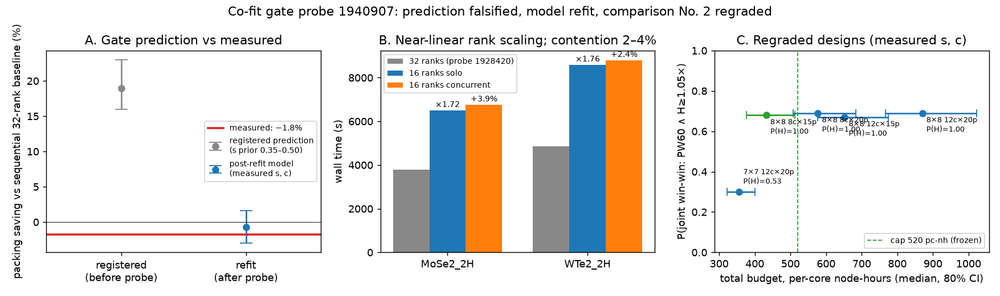

# Co-fit gate probe — results (granite job `1940907`)

Collected 2026-09-11. Job COMPLETED, exit 0, 6 h 38 m wall, 4/4 SCFs
converged, 2.13 per-core node-hours (cap was 6). Raw data:
`cofit_results.jsonl`. Scratch (`$SCRATCH/mpt_cofit`) cleaned at
collection.

## Measurements

| run | ranks | wall (s) | RAM total | contention vs solo |
| --- | ---: | ---: | ---: | ---: |
| MoSe2_2H 6×6 solo | 16 | 6,509.8 | 42.1 GB | — |
| WTe2_2H 6×6 solo | 16 | 8,591.2 | 52.5 GB | — |
| MoSe2_2H 6×6 concurrent | 16 | 6,760.9 | 42.1 GB | +3.9% |
| WTe2_2H 6×6 concurrent | 16 | 8,800.2 | 52.5 GB | +2.4% |

Concurrent 16+16 makespan: **8,800 s**. Sequential 32-rank baseline
(probe `1928420`: 3,777 + 4,868 s): **8,645 s**.

## The registered prediction is falsified

The pre-study registered (before collection): **19% node-time saving,
80% interval 16–23%**. Measured: **−1.8%** — concurrent packing was
*slower* than the sequential baseline. Far outside the interval, so per
the registration a model input is wrong and gets refit.

## Diagnosis: the rank-scaling prior was wrong; everything else checks out

- **Rank scaling `s` (wall(16) = wall(32)·2^s):** prior 0.35–0.50
  (i.e. halving cores costs 1.27–1.41× wall). Measured:
  MoSe2 6,509.8/3,777 = 1.723× → s = 0.785; WTe2 8,591.2/4,868 =
  1.765× → s = 0.820. **These 6×6 jobs scale almost linearly inside
  the node** — the 0.425 exponent fitted on multi-node/small-cell data
  does not transfer intra-node. With no scaling headroom at 16 ranks,
  the predicted makespan saving never existed.
- **Contention `c`:** prior 0.05–0.12 per extra stream. Measured
  0.024–0.039 — co-tenancy is even cheaper than assumed. Contention
  did *not* eat the saving; the prior `s` invented it.
- **Model structure validated:** replaying the scheduler with the
  measured s and c reproduces the probe (predicted makespan ≈8,786 s
  vs 8,800 measured, 0.2% off). After refitting only
  s → (0.76, 0.84) and c → (0.02, 0.05), the model's gate prediction
  becomes −0.7% (80% interval −3.0% to +1.6%) — the measured −1.8%
  falls inside. The physics model is right; one prior was stale.
- **RAM is rank-insensitive:** totals at 16 ranks (42.1/52.5 GB) match
  the 32-rank values (42.6/52.6 GB) within 1%, so the RAM anchors and
  the iso-electron spread (25% here) used by the packing design remain
  valid as-is.
- **Billed footnote:** in TRES per-core node-hours the concurrent pair
  did cost 10% less than the sequential 32-rank baseline (1.081 vs
  1.201 nh) — but that saving comes from running at 16 ranks (better
  parallel efficiency), which either arm can do from class knowledge
  alone. It is not a disclosure gain.

## Gate verdict

As framed ("concurrent 16+16 must beat sequential 32-rank node time by
more than its contention cost") the gate **fails**: at 6×6 there is no
pair-packing makespan gain, exactly consistent with the pre-study's
independent finding that 6×6 is a structural null (memory never binds —
42–53 GB against a 380 GB node). Per the gate's own decision rule, the
H-gain must come from **memory-reservation billing at a scale where
memory binds, with up to 4 co-resident streams** — which is precisely
the amended 8×8 design in `../paired_comparison_2/PREREGISTRATION_DRAFT.md`.

## Post-refit re-grade of comparison No. 2 (400 worlds, measured s and c)

| design | P(H ≥ 1.05×) | median H ratio | P(PW60) | P(joint) | budget med [80% CI] (pc-nh) |
| --- | ---: | ---: | ---: | ---: | ---: |
| 6×6 any | 0.00 | 1.000 | 0.00 | 0.00 | 184 — structural null |
| 7×7, 12 calls × 20 pairs | 0.53 | 1.052 | 0.39 | 0.30 | 356 [322–401] |
| 8×8, 12 calls × 20 pairs | **1.00** | 1.145 | 0.69 | 0.69 | 870 [767–1022] |
| **8×8, 8 calls × 15 pairs** | **1.00** | 1.145 | 0.68 | 0.68 | **432 [376–512]** |

(`../paired_comparison_2/prestudy/prestudy_results_postcofit*.json`; the
corrected s raises every budget ≈30% over the pre-cofit estimates —
16-rank jobs are 1.74× the 32-rank wall, not 1.34×.)

The H-side power is saturated (1.00) at 8×8 for every swept size, and
PW60 is flat at ≈0.68 (world-luck-limited, as diagnosed in
`../metric_redesign/`), so the cheapest adequate design is
**8×8, 8 calls × 15 pairs, ≈432 per-core node-hours** — adopted in the
amended preregistration with a 520 pc-nh cap (the 90th-percentile
budget, rounded).

